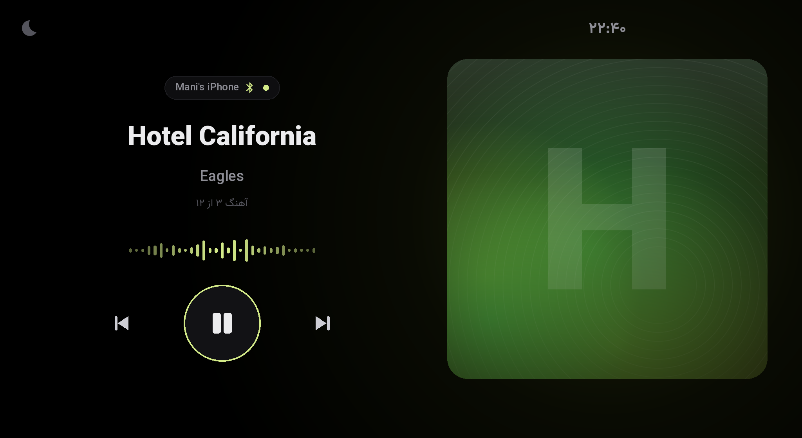

# BlueTune

**A pure-black Bluetooth music player for Android car head units.**

[](https://github.com/mani-imani/BlueTune/actions/workflows/build.yml)
[](https://github.com/mani-imani/BlueTune/releases/latest)
[](LICENSE)
[-3DDC84?logo=android&logoColor=white)](#compatibility)

[فارسی](README.md) · Sibling apps: [DrivePlay](https://github.com/mani-imani/DrivePlay) (USB / SD player) · [DoorAlert](https://github.com/mani-imani/DoorAlert) (open-door alert)



Most aftermarket Android head units ship a bright, bare-bones Bluetooth music screen: three buttons and a stock image. BlueTune replaces it with a screen designed for driving at night: true black, low-glare text, big touch targets and unique artwork for every song.

## Features

- **True black (`#000`).** Nothing on screen is brighter than it needs to be, and the accent colour comes from each song's artwork.
- **Generated cover art.** The head unit never receives real album art, so BlueTune generates artwork from the title and artist. Each song always gets the same artwork: a deep gradient, light blooms, faint vinyl grooves and the song's first letter.
- **Live waveform.** It breathes gently while music plays and settles into a row of dots when paused.
- **Night dim.** The 🌙 button darkens the whole screen by 50%. The choice is remembered.
- **Song info:** title, artist, track number in the queue and the connected phone's name.
- **Controls:** play/pause, next and previous. Buttons respond instantly and stay in sync with the real playback state.
- **Persian-first UI** with the Vazirmatn font and Persian digits. Latin titles render cleanly too.
- **Adaptive layout** for landscape and portrait. The info column scales as a whole to fit any screen.
- **Keeps the screen on** while open.
- **Full-screen:** the head unit's top bar hides; swipe down or tap the top edge to show it for a few seconds.
- **Clock** above the cover.
- **Driver-side controls:** controls on the left, cover on the right.

## Compatibility

| | |
|---|---|
| **Tested car** | JAC S3 |
| **Head unit** | ZQ8003 · board `ZQ_MTK_8007` · MediaTek |
| **Android** | 9 (API 28) |
| **Phone** | iPhone over Bluetooth (any phone that pairs with the head unit should work) |

BlueTune talks to the head unit's vendor `car` service (the `android.car.server` firmware family used by many Chinese head units). Other units running the same firmware will likely work. Units without that service show *“head unit service unavailable”*.

## Install

1. Download `BlueTune.apk` from the [latest release](https://github.com/mani-imani/BlueTune/releases/latest).
   Direct link: `https://github.com/mani-imani/BlueTune/releases/latest/download/BlueTune.apk`
2. Install it on the head unit. You can open the link in the unit's browser over a phone hotspot, or copy the APK over on a USB stick. Allow installs from unknown sources if asked.
3. Open **BlueTune** from the app drawer.

> If the old version of this app, named GeekPlay, is on your head unit, uninstall it first. The app ID changed, so the two install side by side.

> If you installed a pre-1.1.0 test build, uninstall it once first. From 1.1.0 on, every build is signed with the same key and installs as an update.

## How it works

The head unit handles Bluetooth through a separate module (`BLINK_MTK`), not Android's own Bluetooth stack. That means the standard Android media APIs (such as `MediaSession`) can't see Bluetooth music.

We used a small diagnostic app, [GeekProbe](https://github.com/mani-imani/GeekProbe), to extract the head unit's system apps, then decompiled them. That showed the vendor's Bluetooth app talks to a Binder service named `car`:

| | |
|---|---|
| Service | `ServiceManager.getService("car")` → `android.car.server.ICarService` |
| Read state | `requestSync("request.dm.get_value", {key, type})` |
| Commands | `requestOneway("request.bt.a2dp_play_pause" / "a2dp_next" / "a2dp_prev")` |
| Song info | `state.bt.avrcp_info` → `String[]{title, artist, totalTime, index, count}` |
| Playback | `state.bt.a2dp_state` (0 idle · 1 playing · 2 paused · 3 stopped) |
| Connection | `state.bt.hfp_state`, `state.bt.remote_name` |
| Audio source | `state.app.cur_source`, `request.app.enter_app` (BT music = `65537`) |

BlueTune implements this wire protocol directly ([`CarBt.java`](app/src/main/java/ir/maniimani/bluetune/CarBt.java)). It uses no vendor libraries.

### Limitations

These come from the head unit itself, and BlueTune can't work around them:

- **No seeking.** The Bluetooth module only accepts play/pause, next and previous.
- **No playback position.** The unit never receives the current position from the phone, so a decorative waveform stands in for a progress bar.
- **No real album art.** The unit never receives album art, so BlueTune shows its own generated artwork.

## Building

GitHub Actions builds on every push to `main`. When `versionName` changes, the APK is also published to Releases automatically. To build locally:

```bash
# JDK 17 + Android SDK (compileSdk 34) + Gradle 8.7
gradle assembleRelease
# → app/build/outputs/apk/release/app-release.apk
```

To release, bump `versionName` (and `versionCode`) in `app/build.gradle`, add a `## 1.2.0` section to `CHANGELOG.md`, and push. The `v1.2.0` tag and release are created automatically.

> The signing key (`app/bluetune.keystore`) is committed on purpose so every build installs over the previous one. This is a sideloaded personal app, and the key is not meant for Google Play.

## Project structure

```
app/src/main/java/ir/maniimani/bluetune/
├── MainActivity.java   UI, layout, state handling
├── CarBt.java          Binder client for the head unit's "car" service
├── Art.java            Deterministic generated cover art + palette
├── ArtworkView.java    Rounded cover with cross-fade
├── GlowView.java       Black background with a soft coloured bloom
├── WaveView.java       Decorative live waveform
└── PlayButton.java     Always-circular play/pause button
```

## Built with Claude

This project was built from first idea to finished app with **[Claude](https://claude.ai)** by Anthropic, on a **Claude Pro** plan. Claude worked through every stage: investigating the head unit, writing the diagnostic tool, reverse-engineering the vendor `car` service protocol from the decompiled system apps, designing the UI, writing the code and setting up CI. I did the real-car testing and made the design decisions.

## Author

**Mani ImaniSanjar** · [GeekMani](https://t.me/geekmani)
[maniimani.ir](https://maniimani.ir) · [GitHub](https://github.com/mani-imani) · [LinkedIn](https://linkedin.com/in/mani-imani)

## License

Code is released under the [MIT](LICENSE) license. The bundled [Vazirmatn](https://github.com/rastikerdar/vazirmatn) font is under the SIL OFL 1.1.

This is an independent project, not affiliated with the head unit manufacturer or JAC Motors. Screenshots are UI previews, and the song titles are used only as examples.
