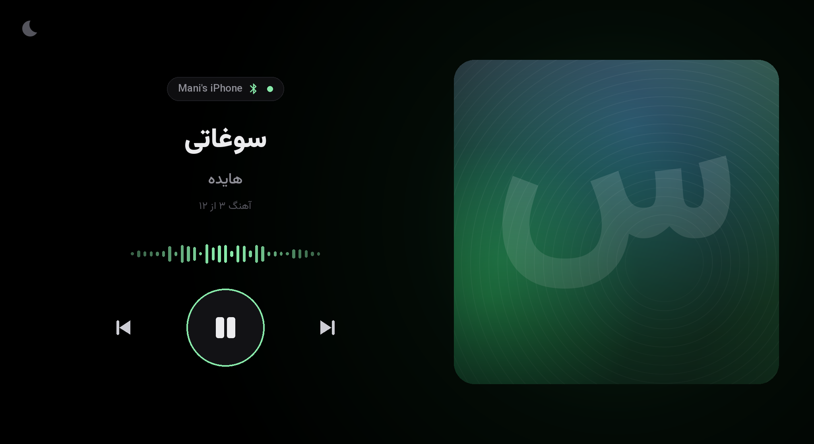
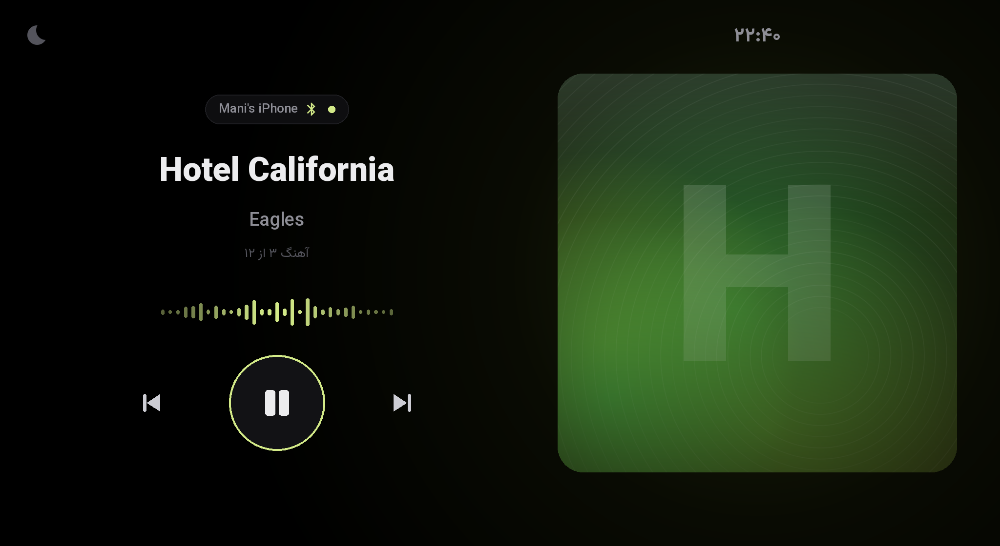

<div dir="rtl">

# GeekPlay

**پلیر موزیک بلوتوث با تم مشکی کامل، برای مانیتورهای اندرویدی ماشین**

[](https://github.com/mani-imani/GeekPlay/actions/workflows/build.yml)
[](https://github.com/mani-imani/GeekPlay/releases/latest)
[](LICENSE)
[-3DDC84?logo=android&logoColor=white)](#سازگاری)

[English README](README.en.md)



بیشتر مانیتورهای اندرویدی ماشین برای پخش موزیک از بلوتوث یه صفحه‌ی ساده و روشن دارن: سه تا دکمه و یه عکس ثابت. GeekPlay جای اون صفحه رو می‌گیره، با طراحی‌ای که برای رانندگی در شب ساخته شده: پس‌زمینه‌ی مشکی کامل، متن‌های کم‌نور، دکمه‌های بزرگ و یه کاور اختصاصی برای هر آهنگ.

## ویژگی‌ها

- **تم مشکی کامل (`#000`).** هیچ‌جای صفحه از اندازه‌ی لازم روشن‌تر نیست، و رنگ صفحه از کاور هر آهنگ گرفته می‌شه.
- **کاور ساختگی برای هر آهنگ.** مانیتور کاور واقعی رو از گوشی نمی‌گیره، برای همین GeekPlay برای هر آهنگ یه کاور می‌سازه. کاور از اسم آهنگ و خواننده ساخته می‌شه و هر آهنگ همیشه همون کاور خودش رو داره: گرادیانت عمیق، لکه‌های نور، شیارهای محو مثل صفحه‌ی گرامافون، و حرف اول اسم آهنگ.
- **موج زنده.** موقع پخش آروم تکون می‌خوره و موقع توقف آروم می‌شه و فقط چند نقطه ازش می‌مونه.
- **حالت شب.** با دکمه‌ی ماه، کل صفحه ۵۰٪ تیره‌تر می‌شه و اپ این انتخاب رو یادش می‌مونه.
- **اطلاعات آهنگ:** اسم آهنگ، خواننده، شماره‌ی آهنگ توی لیست و اسم گوشی وصل‌شده.
- **کنترل‌ها:** پخش و توقف، آهنگ بعدی، آهنگ قبلی. دکمه‌ها بدون تأخیر جواب می‌دن و صفحه با وضعیت واقعی پخش هماهنگ می‌مونه.
- **فارسی کامل** با فونت وزیرمتن و اعداد فارسی.
- **اندازه‌ی خودکار.** چیدمان خودش رو با اندازه‌ی صفحه و جهت افقی یا عمودی تنظیم می‌کنه.
- **صفحه خاموش نمی‌شه** تا وقتی اپ بازه.
- **تمام‌صفحه:** نوار بالای مانیتور پنهان می‌شه و با کشیدن یا لمس لبه‌ی بالای صفحه چند ثانیه نمایش داده می‌شه.
- **ساعت** بالای کاور.
- **دکمه‌ها سمت راننده:** کنترل‌ها سمت چپ صفحه‌ان و کاور سمت راست.

<div dir="ltr">

| فارسی | English |
|:---:|:---:|
|  |  |

</div>

## سازگاری

| | |
|---|---|
| **ماشین تست‌شده** | جک S3 (JAC S3) |
| **مانیتور** | ZQ8003 · برد `ZQ_MTK_8007` · MediaTek |
| **اندروید** | 9 (API 28) |
| **گوشی** | آیفون از راه بلوتوث (هر گوشی‌ای که با بلوتوث مانیتور وصل بشه باید کار کنه) |

GeekPlay به سرویس سیستمی `car` مانیتور وصل می‌شه، که مخصوص یه خانواده از فریم‌ورهای مانیتورهای چینیه (`android.car.server`). روی مانیتورهای دیگه‌ای که همین فریم‌ور رو دارن احتمالاً کار می‌کنه، ولی روی مانیتورهایی که سیستمشون فرق داره، اپ پیغام «سرویس مانیتور در دسترس نیست» نشون می‌ده.

## نصب

1. فایل `GeekPlay.apk` رو از [آخرین Release](https://github.com/mani-imani/GeekPlay/releases/latest) دانلود کن.
   لینک مستقیم: `https://github.com/mani-imani/GeekPlay/releases/latest/download/GeekPlay.apk`
2. روی مانیتور نصبش کن. می‌تونی مانیتور رو به هات‌اسپات گوشی وصل کنی و لینک رو توی مرورگرش باز کنی، یا APK رو با فلش منتقل کنی. اگه پیغام «منبع ناشناس» اومد، اجازه‌ی نصب رو بده.
3. GeekPlay رو از منوی اپ‌ها باز کن.

> اگه یکی از نسخه‌های آزمایشی قبل از 1.1.0 رو نصب کردی، یه بار پاکش کن و بعد نسخه‌ی جدید رو نصب کن. از نسخه‌ی 1.1.0 به بعد، هر نسخه‌ی جدید مستقیم روی نسخه‌ی قبلی نصب می‌شه.

## استفاده

- گوشی رو با بلوتوث به مانیتور وصل کن و یه آهنگ پخش کن. GeekPlay خودکار اطلاعات آهنگ رو نشون می‌ده.
- اگه منبع صدای مانیتور روی بلوتوث نباشه (مثلاً روی رادیو باشه)، دکمه‌ی **«پخش از بلوتوث»** ظاهر می‌شه. این دکمه اپ بلوتوث سازنده رو یه لحظه باز می‌کنه و خودکار برمی‌گرده به GeekPlay.
- برای تیره‌تر کردن صفحه در شب، دکمه‌ی 🌙 گوشه‌ی صفحه رو بزن.

## چطور کار می‌کنه

مانیتور بلوتوث رو با یه ماژول جدا (`BLINK_MTK`) مدیریت می‌کنه، نه با بلوتوث استاندارد اندروید. برای همین اپ‌های معمولی نمی‌تونن از راه‌های استاندارد اندروید (مثل `MediaSession`) به موزیک بلوتوث دسترسی داشته باشن.

برای پیدا کردن راه دسترسی، اول با ابزار تشخیصی [GeekProbe](https://github.com/mani-imani/GeekProbe) اپ‌های سیستمی مانیتور رو بیرون کشیدیم و بعد کدشون رو بررسی کردیم. معلوم شد اپ بلوتوث خود سازنده از یه سرویس Binder به اسم `car` استفاده می‌کنه. سرویس از این راه‌ها در دسترسه:

<div dir="ltr">

| | |
|---|---|
| Service | `ServiceManager.getService("car")` → `android.car.server.ICarService` |
| Read state | `requestSync("request.dm.get_value", {key, type})` |
| Commands | `requestOneway("request.bt.a2dp_play_pause" / "a2dp_next" / "a2dp_prev")` |
| Song info | `state.bt.avrcp_info` → `String[]{title, artist, totalTime, index, count}` |
| Playback | `state.bt.a2dp_state` (0 idle · 1 playing · 2 paused · 3 stopped) |
| Connection | `state.bt.hfp_state`, `state.bt.remote_name` |
| Audio source | `state.app.cur_source`, `request.app.enter_app` (BT music = `65537`) |

</div>

GeekPlay همین پروتکل رو مستقیم پیاده‌سازی می‌کنه (فایل [`CarBt.java`](app/src/main/java/ir/maniimani/geekplay/CarBt.java)) و از هیچ کتابخونه‌ی سازنده استفاده نمی‌کنه.

### محدودیت‌ها

این محدودیت‌ها از خود مانیتوره و GeekPlay نمی‌تونه دورشون بزنه:

- **جلو و عقب بردن آهنگ ممکن نیست.** ماژول بلوتوث مانیتور فقط دستورهای پخش و توقف، بعدی و قبلی رو می‌شناسه.
- **ثانیه‌ی فعلی آهنگ رو نمی‌شه نشون داد.** مانیتور این عدد رو از گوشی نمی‌گیره. برای همین اپ به جای نوار زمان یه موج تزئینی داره.
- **کاور واقعی آهنگ نمیاد.** کاور اصلی آهنگ به مانیتور نمی‌رسه و اپ کاور ساختگی خودش رو نشون می‌ده.

## ساخت از سورس

با هر push به شاخه‌ی `main`، GitHub Actions اپ رو می‌سازه. اگه `versionName` عوض شده باشه، APK خودکار توی Releases هم منتشر می‌شه. برای ساخت روی سیستم خودت:

<div dir="ltr">

```bash
# JDK 17 + Android SDK (compileSdk 34) + Gradle 8.7
gradle assembleRelease
# → app/build/outputs/apk/release/app-release.apk
```

</div>

برای انتشار یه نسخه‌ی جدید، `versionName` (و `versionCode`) رو توی `app/build.gradle` بالا ببر، یادداشت‌های نسخه رو با عنوان `## 1.2.0` به `CHANGELOG.md` اضافه کن و push کن. تگ `v1.2.0` و Release خودکار ساخته می‌شن.

> کلید امضای APK (`app/geekplay.keystore`) عمداً توی ریپو گذاشته شده تا همه‌ی نسخه‌ها با یه کلید امضا بشن و روی هم نصب بشن. این اپ برای نصب دستیه، و این کلید برای Google Play در نظر گرفته نشده.

## ساختار پروژه

<div dir="ltr">

```
app/src/main/java/ir/maniimani/geekplay/
├── MainActivity.java   UI, layout, state handling
├── CarBt.java          Binder client for the head unit's "car" service
├── Art.java            Deterministic generated cover art + palette
├── ArtworkView.java    Rounded cover with cross-fade
├── GlowView.java       Black background with a soft coloured bloom
├── WaveView.java       Decorative live waveform
└── PlayButton.java     Always-circular play/pause button
```

</div>

## ساخته‌شده با Claude

این پروژه از اولین ایده تا نسخه‌ی نهایی با کمک **[Claude](https://claude.ai)** ساخته شد، دستیار هوش مصنوعی شرکت Anthropic، روی اشتراک **Claude Pro**. Claude توی همه‌ی مراحل نقش داشت: بررسی سخت‌افزار مانیتور، ساخت ابزار تشخیصی، باز کردن کد اپ‌های سیستمی برای پیدا کردن پروتکل سرویس `car`، طراحی رابط کاربری، نوشتن کد و راه‌اندازی بیلد خودکار. تست روی ماشین واقعی و تصمیم‌های طراحی هم کار خودم بود.

## سازنده

**مانی ایمانی‌سنجر** · [GeekMani](https://t.me/geekmani)
[maniimani.ir](https://maniimani.ir) · [GitHub](https://github.com/mani-imani) · [LinkedIn](https://linkedin.com/in/mani-imani)

## مجوز

کد با مجوز [MIT](LICENSE) منتشر شده. فونت [وزیرمتن](https://github.com/rastikerdar/vazirmatn) با مجوز SIL OFL 1.1 همراه اپ قرار گرفته.

این پروژه مستقله و هیچ ارتباطی با سازنده‌ی مانیتور یا خودروسازی جک نداره. عکس‌های این صفحه پیش‌نمایش رابط کاربری‌ان، و اسم آهنگ‌ها فقط برای نمونه آورده شدن.

</div>
